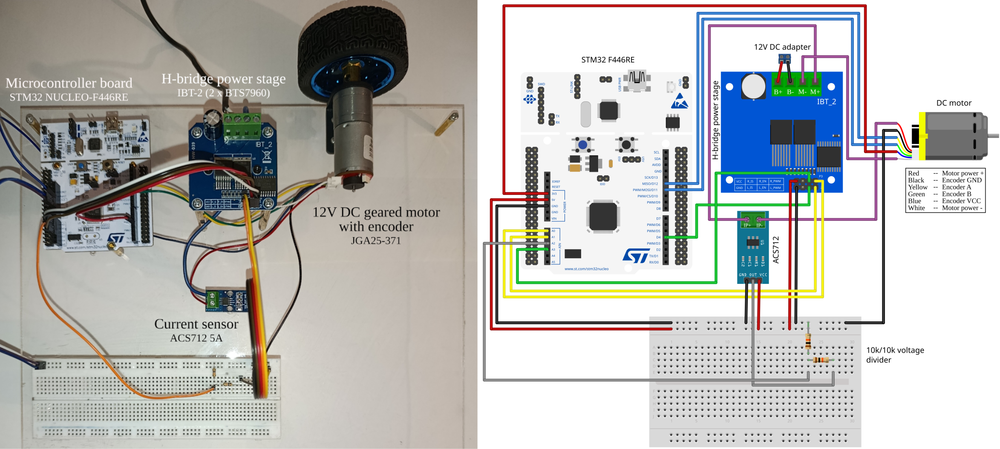
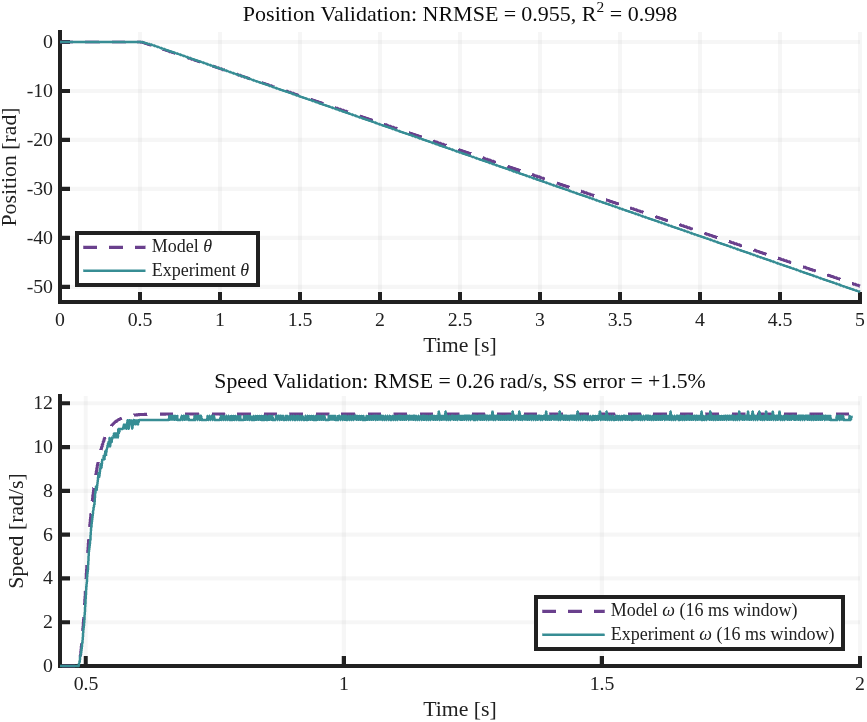
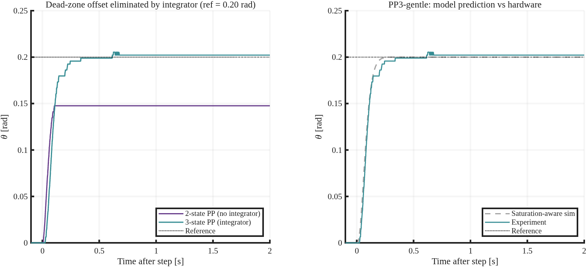
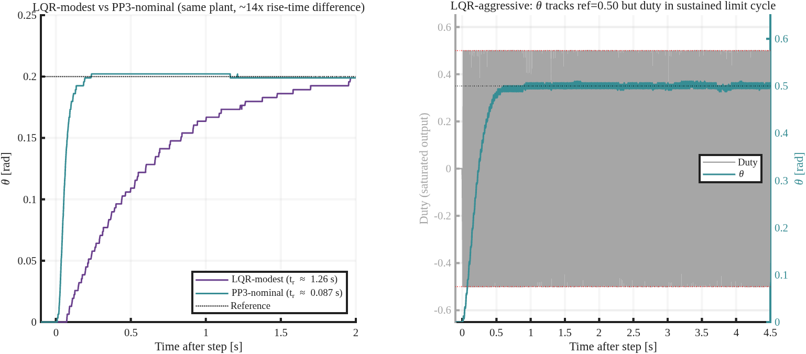
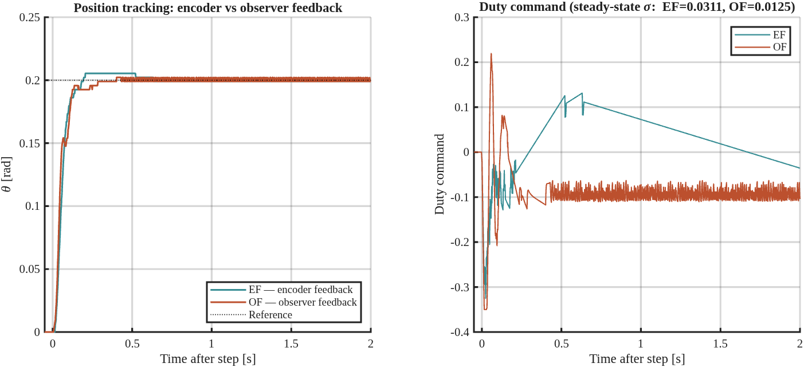
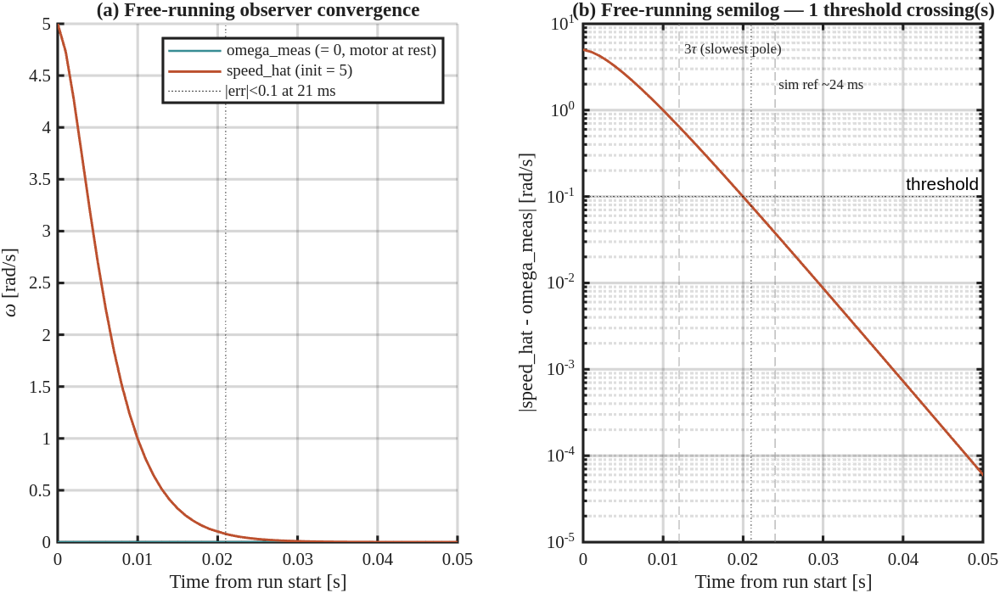
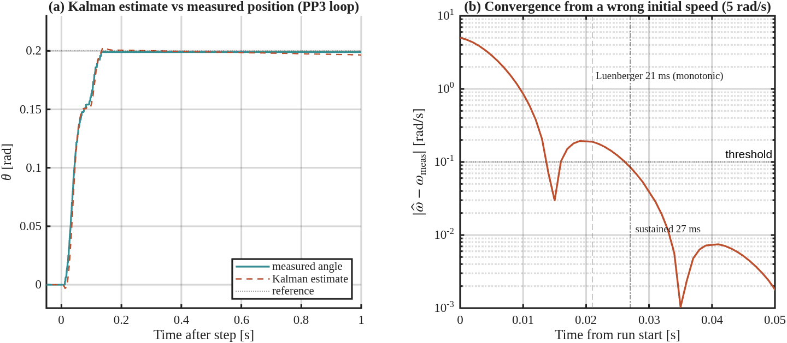
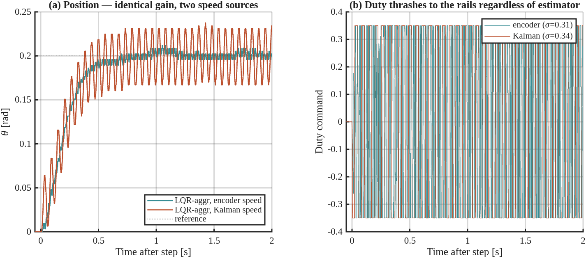
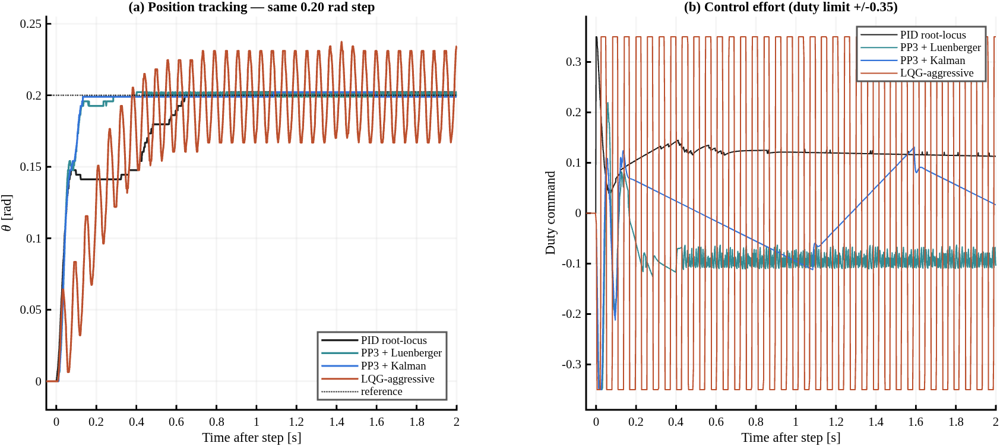

# DC Motor Control Test Rig

A low-cost open-source experimental test rig for DC motor characterization and embedded control. The rig supports reproducible experiments from basic motor modeling to advanced control design.

<p align="center">
  
</p>

Motor operation with live current logging in Simulink:

<table align="center">
<tr>
<td>

https://github.com/user-attachments/assets/1edbcfd7-645a-4d96-b34e-ac3db928e8e8

</td>
</tr>
</table>

## Repository Layout

```text
hardware/       Hardware datasheets, wiring diagram, and rig image/video
firmware/       STM32 firmware, generated embedded code, board-level configuration
matlab/         MATLAB scripts/Simulink models for identification, validation, control
data/           Raw and processed experiment data used to reproduce plots/metrics
results/        Result plots
```

## Completed Experiments

- [x] Hardware rig assembled
- [x] Position and speed based model validation
- [x] PI speed control
- [x] State-space position control (pole placement + LQR)
- [x] Observer-based estimation (Luenberger + Kalman / LQG)
- [x] Controller comparison (PID, observer-based pole placement, and LQG)

## Motor Identification and Model Validation

Motor parameters were identified by classical lumped-element methods: `R_a` from locked-rotor current; `K` and `b` from steady-state voltage–speed and torque–speed measurements; `J` from a coast-down test.

| Parameter | Value | Note |
|---|---:|---|
| `Ra` | 2.1 Ω | Armature resistance |
| `La` | 100 µH | Armature inductance (assumed for now) |
| `K` | 0.59 V s/rad | Back-EMF / torque constant (output-shaft referred) |
| `J` | 2.03e-3 kg m² | Equivalent inertia (output-shaft referred) |
| `b` | 0.0164 N m s/rad | Viscous friction (output-shaft referred) |

Using these parameters, the model closely matches the measured position response for the voltage-step validation test (`NRMSE = 0.955`, `R^2 = 0.998`).

<p align="center">
  
</p>

The motor was further characterized using an open-loop duty staircase. The identified model was then validated on a separate single-step experiment: a `0.6` duty command applied at `t = 0.5 s`. The model predicts the measured speed response closely:

- RMSE over the step response: `0.26 rad/s`
- Steady-state speed error: `+1.5%`
- Speed estimate: encoder position forward difference with 16 ms window


## PI Speed Control

PI speed control was designed using the experimentally identified first-order speed model of motor:

$$
G(s)=\frac{K_{dc}}{\tau s+1}
$$

where $K_{dc} = 19.524~\text{rad/s/duty}$ and $\tau=0.018~\text{s}$. The controller gains were selected by matching the closed-loop denominator to a second-order target with $\omega_n=50~\text{rad/s}$ and $\zeta=0.9$, giving $K_p = 0.0318$ and $K_i = 2.3049$.

The figure below compares the saturation-aware simulation with the real motor-rig response for a $10~\text{rad/s}$ speed step. The raw embedded speed estimate is shown for transparency, but performance metrics are computed from a 50 ms angle-slope estimate to reduce encoder quantization effects.

Angle-derived experimental metrics:

- Peak speed: $10.51~\text{rad/s}$
- Overshoot: 5.1%
- Rise time: $44~\text{ms}$
- Settling time (2%): $127~\text{ms}$
- Steady-state error: Approx. $3.5e-4~\text{rad/s}$

<p align="center">
  
</p>


## State-Space Position Control

The law used by state-space controllers is: `u = −Kx`. The following work answers two questions in turn: (i) how to choose the gain K (through pole placement or LQR), (ii) how to get the speed state ω (from the encoder count difference, a Luenberger observer, or a Kalman estimator). Pole placement and the Luenberger observer are designed by choosing poles, while LQR and the Kalman estimator are designed by minimizing a cost. LQR combined with a Kalman estimator is known as LQG.

The PI speed plant was extended to a 2-state position model `x = [θ, ω]ᵀ` and a 3-state form `x_aug = [x_i, θ, ω]ᵀ` with an integrator on the tracking error. Three controller families were designed and deployed with references of 0.20 rad and 0.50 rad:

1. **2-state pole placement (PP2):** `K = [K_θ, K_ω]` plus feedforward `Nbar`
2. **3-state pole placement with integrator (PP3):** `K_aug = [K_i, K_θ, K_ω]`, no `Nbar` since the integrator handles DC tracking
3. **LQR** on the same 3-state plant: gains from `lqr(A_aug, B_aug, Q, R)`

### Pole placement (PP): dead zone discovery and integrator fix

Without the integrator, the controller stalls before reaching the reference because the residual duty falls below the motor's static friction threshold. Adding an integrator state eliminates this offset and the saturation-aware simulation tracks the 3-state hardware response within the noise floor.

<p align="center">
  
</p>

Results (reference = 0.20 rad):

- **2-state PP-gentle:** steady-state offset ≈ **26 %** (motor stalls at 0.148 rad)
- **Residual duty at motor stall:** ≈ **6 % PWM duty** (similar in four PP2 runs), which is below the dead zone of +15 % (forward) and −11 % (reverse) duty measured in separate tests. Since the PP2 output depends only on current position and speed, the duty gets frozen at this value once the motor stops. An integrator is needed to keep raising the duty.
- **3-state PP-gentle (with integrator):** steady-state offset ≈ **1 %** (reaches 0.20 rad)
- **Model vs hardware (PP3-gentle):** steady-state match within encoder resolution

### LQR: methodology comparison and a limit-cycle finding

LQR on the same plant chooses gains by minimizing a quadratic cost rather than placing specific poles. Conservative weights produce a clean, low-jitter response but at much lower bandwidth than the equivalent pole-placement design. Aggressive weights raise the bandwidth. But on hardware, the closed loop falls into a sustained limit cycle: position still tracks the reference, but the control effort thrashes between duty saturation rails.

<p align="center">
  
</p>

Results:

- **LQR-modest (ref 0.20 rad):** 10–90 rise time ≈ **1.26 s** vs PP3-nominal's **0.087 s** with comparable steady-state accuracy but ~14× slower bandwidth.
- **LQR-aggressive (ref 0.50 rad):** position σ over last 1 s ≈ **5 mrad**, but duty σ ≈ **0.47** with peaks at the ±0.50 saturation rails; peak current ≈ **4.4 A**. The LQR design assumes a linear plant. It does not include the dead zone or saturation, which interact with its high gains on the hardware. 

More weights can be tried to improve the LQR controller performance.

### Luenberger observer: model-based speed feedback

A discrete Luenberger observer was added to the 3-state pole placement position controller. The observer estimates `x = [theta, omega]^T` from commanded duty and encoder position. It does not differentiate the encoder signal for speed. The controller gains are unchanged from the PP3-nominal design (`K = [-103.7, 6.04, 0.073]`). Two speed feedback sources are used: Filtered encoder derivative (`omega_meas`) and observer estimate (`speed_hat`).

<p align="center">
  
</p>

Results for a `0.20 rad` position step:

- **Steady state:** Both settle within one encoder count but in different manners. Using encoder feedback, the motor stops one count below the reference and the integrator slowly ramps the duty to overcome the dead zone and the motor moves by one count. With observer feedback, the position oscillates between the two encoder counts around the reference with a fast duty jitter. 
- **Overshoot:** `1.1%` with observer feedback vs `2.7%` with encoder-speed feedback (one encoder count difference).
- **Rise time:** `92 ms` with observer feedback vs `83 ms` with encoder-speed feedback.

In practice, an observer starts by guessing a speed (usually zero). Obviously this is a wrong estimate initially. How quickly this error is addressed depends on the observer gain `L` and not on the controller. To test this on the rig, the observer was tested with an intentionally wrong initial speed estimate: $\hat{\omega}(0) = 5$ rad/s.

<p align="center">
  
</p>

Convergence results:

- **Observer alone:** Controller employs the encoder speed, the reference is zero and the motor stays at rest, so only the observer error changes. The speed estimate reaches less than `0.1 rad/s` within `21 ms` and stays below it, close to the simulated `24 ms`.
- **Observer in the loop:** The controller receives the incorrect speed estimate. The duty gets saturated briefly and the motor moves, but the control loop stays stable and then tracks the reference.

The first test evaluates the observer on its own while the second checks if an incorrect speed estimate could destabilize the closed loop.


### Kalman estimator and Linear–quadratic–Gaussian (LQG) control

The Kalman estimator shares the same structure as the Luenberger observer with the exception that gain `L` is computed differently. Instead of direct placement of observer poles, the gain is decided based on two noise levels: (i) the measurement noise `R` based on encoder resolution (one count, `q = 3.21 mrad`, modelled as a uniform error of `±q/2` to give `R = q²/12`), (ii) the process noise `Q` representing the unmodelled torque acting on the speed, and it was chosen to give an estimator of similar speed to the Luenberger observer for reliable comparison.   

Two tests were run: (i) the Kalman estimator replaced the Luenberger observer in the pole placement loop. (ii) the Kalman estimator is combined with the aggressive LQR gain to form the LQG controller.

<p align="center">
  
</p>

Results with the pole placement controller (`0.20 rad` step response):

- **Tracking:** The controller uses the measured position and the Kalman speed estimate. Similar to the Luenberger results, the measured position overshoots by `1.1%` with a steady-state error less than one encoder count. The Kalman position estimate follows the measured position closely and is not used by the controller.

- **Convergence from a wrong speed estimate** ($\hat{\omega}(0) = 5$ rad/s, motor at rest): Since its poles are complex, the Kalman estimate overshoots, passing through zero to ~−0.19 rad/s. It first drops below `0.1 rad/s` at `14 ms` and stays below from `27 ms`, while the Luenberger estimate reached this in `21 ms` without overshoot.

Another experiment tested whether a smoother speed estimate eliminates the limit cycle of the aggressive LQR gain. With pole placement controller, the Kalman estimate is smoother than the encoder derived speed since it combines the model with encoder.

The same gain was run twice, once with the encoder speed and once with the Kalman estimate, with everything else unchanged (reference `0.20 rad`, duty limit `±0.35`).


<p align="center">
  
</p>

- **The limit cycle stays with both speed sources.** The duty oscillates between the `±0.35` limits and the position does not settle.
- **The oscillation is larger with the Kalman estimate:** About `67 mrad` peak-to-peak (21 encoder counts) at 17 Hz against `10 mrad` (3 counts) at 49 Hz with encoder speed. Both oscillate around the reference and peak current rises from `2.85 A` to `3.33 A`.
- **Conclusion:** The change in the speed source did not eliminate the limit cycle. The likely cause seems to be the controller gain. In aggressive LQR design, the speed is multiplied by a gain 13 times larger than the one used in pole placement design (`K_ω = 0.97` vs `0.073`). To be investigated more later on.  

## Controller Comparison

Four controller configurations were tested using the same `0.20 rad` step input and `±0.35` duty limit: PID, pole placement with Luenberger observer feedback, pole placement with Kalman estimator feedback, and aggressive LQG.

<p align="center">
  
</p>

| Controller | Rise `t_r` [ms] | Overshoot [%] | Settling `t_s` [ms] | `e_ss` [mrad] | Duty `σ` | Effort `∫u²dt` | `I_peak` [A] |
|---|---:|---:|---:|---:|---:|---:|---:|
| PID (classical) | 550 | 1.1 | 641 | −1.1 | 0.003 | 0.06 | 1.94 |
| PP3 + Luenberger | 92 | 1.1 | 284 | 0.01 | 0.013 | 0.04 | 1.65 |
| PP3 + Kalman | 90 | 1.1 | 132 | 0.26 | 0.028 | 0.02 | 1.97 |
| LQG-aggressive (optimal-control gain + Kalman) | 299 | — * | — * | −0.35 | 0.342 | 0.53 | 3.33 |

<sub>* sustained limit cycle (67 mrad peak-to-peak at 17 Hz around the reference) makes the overshoot and settling time undefined. Steady-state figures are for the final 1 s. One encoder count = 3.21 mrad. </sub>

- **PID** results in a steady-state error smaller than one encoder count (3.2 mrad), but with a rise time about 6 times longer. The motor stops every time the duty falls into the dead zone. The integral term then raises the duty to move the motor again.
- **Pole placement with observer feedback** is the best overall design: ~`90 ms` rise time, steady-state error of less than one encoder count, and the lowest control effort. A slight difference between the two observers: Luenberger settles with lower duty `σ`, while Kalman settles the fastest.
- **LQG-aggressive** (aggressive LQR gain with Kalman estimator) keeps oscillating around the reference position (67 mrad peak-to-peak at 17 Hz). The duty keeps switching between the `±0.35` limits which means the controller behaves as an on/off switch. It uses more than 10 times the control effort and almost twice the peak current of pole placement designs. 

Main result: Pole placement with an observer resulted in the best performance. Both observers gave similar performance. The aggressive LQR gain oscillated with both speed sources (encoder derivative or Kalman estimate) pointing to the gain as the likely issue rather than the speed signal.


## Citation

If you use this project or build on the test rig design, please cite:

```bibtex
@misc{ahmed2026dcmotorcontroltestrig,
  title        = {DC Motor Control Test Rig},
  author       = {Ahmed, Kazi Sher},
  year         = {2026},
  howpublished = {\url{https://github.com/Kazi-Sher/DC-Motor-Control-Testrig}},
  note         = {Open-source hardware and control test rig}
}
```
